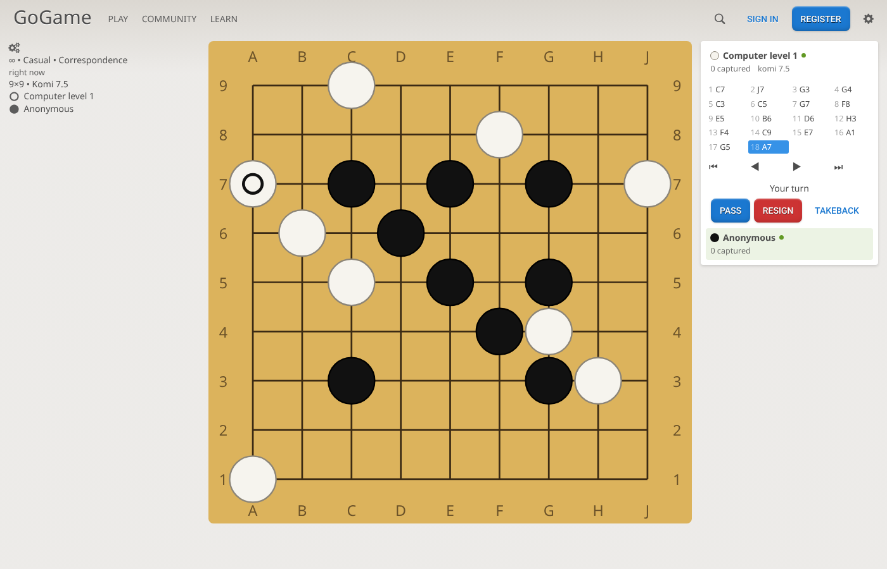
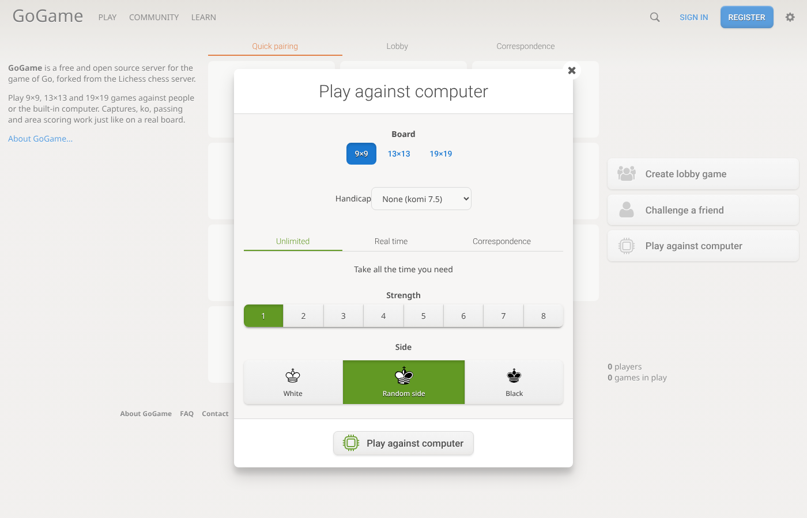
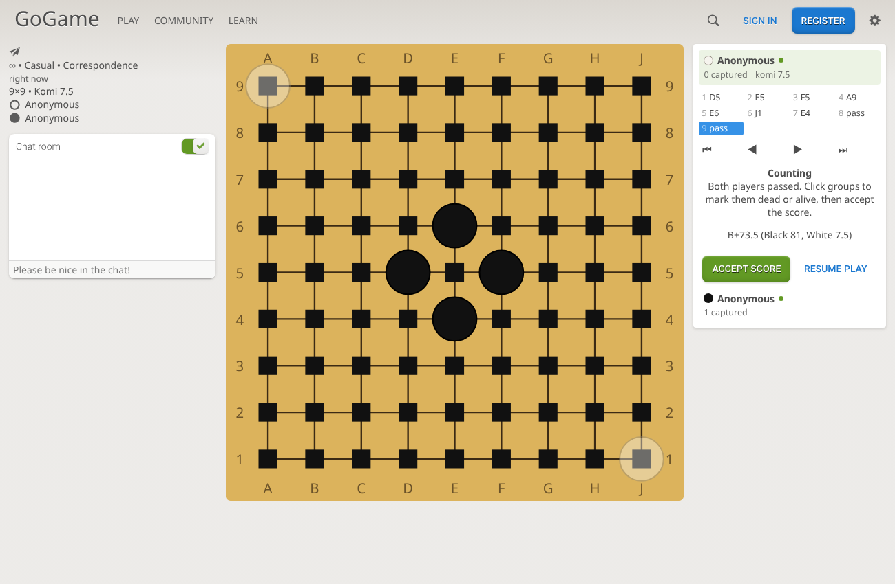

# GoGame — a Go server forked from Lichess

GoGame is a free, open source server for the game of **Go** (Baduk, Weiqi), built by
forking [lila](https://github.com/lichess-org/lila), the server behind
[lichess.org](https://lichess.org), and its websocket server
[lila-ws](https://github.com/lichess-org/lila-ws), and replacing chess with Go.

It keeps Lichess's architecture and platform features — accounts, ratings, a realtime
lobby with seeks and quick pairing, friend challenges, rematches, chat, takebacks,
clocks, correspondence games, notifications, messages — and swaps the game itself.

> This branch replaces the earlier Flutter app that lives on `main` / `development`.



## What you can do

- Play **9×9, 13×13 and 19×19** games, with an optional **handicap** (2–9 stones, komi 0.5)
- Play against people: lobby seeks, quick-pairing pools (19×19), or a challenge link
- Play against the computer, levels 1–8: a **built-in** Monte-Carlo bot, or optionally
  **[KataGo](https://github.com/lightvector/KataGo)** (see below)
- Real time, correspondence, or unlimited games, Glicko-2 ratings per speed
- Pass, resign, abort, takebacks, rematch
- **Counting phase** after two passes: the server proposes dead stones, players click
  groups to toggle them, both accept, and the game is scored with **area (Chinese) rules**
- Review finished games move by move, and **download them as SGF**
- A signup captcha that is a small "capture the stones" Go problem

| New game dialog | Counting after two passes |
| --- | --- |
|  |  |

## How the fork is organised

| Path | What it is |
| --- | --- |
| `modules/goban` | **New.** The Go rules engine: board, captures, suicide, positional superko, handicap placement, area scoring, SGF read/write, the Monte-Carlo bot, and a GTP client for external engines such as KataGo. Pure Scala, unit tested. |
| `modules/core`, `game`, `round`, `lobby`, `setup`, `challenge`, `pool` | Lichess modules converted from chess to Go. `core.Game` now wraps `goban.Game`; games are stored as SGF move keys plus board size, komi, handicap and dead stones. |
| `modules/*` (others) | Lichess platform modules kept as-is or lightly trimmed: users, security, OAuth, prefs, ratings, chat, messages, notifications, relations, reports, playbans, i18n, web. |
| `app/` | The Play application: controllers, views and routes for the kept features. |
| `ws/` | lila-ws, adapted to forward Go moves, passes and scoring actions, and to push Go boards to live mini games. |
| `ui/round` | **New.** The game page: an SVG goban, move list and replay, clocks and controls, written with snabbdom. |
| `ui/lobby`, `ui/lib`, `ui/site`, `ui/bits` | Lichess's front end, converted to Go (setup dialog, mini boards, captcha). |

Removed from Lichess because they are chess specific: puzzles, studies, the analysis
board and Stockfish/fishnet, opening explorer, insights, tutor, learn and practice,
tournaments/swiss/simuls (they depend on chess pairing and display code), broadcasts,
TV, forums, teams, blogs, streamers, coaches, classes and the chess board editor.
Links that pointed to them now go to the home page (`lila.ui.deadLink` in the code
marks them).

### How a move travels

```
browser ── websocket ──> lila-ws ── redis ──> lila (round module)
   ^                                              │ goban.Game.apply(move)
   └──────── move event (board, captures, clock) ─┘
```

The client sends SGF coordinates (`"pd"`) or `"pass"`. The server is authoritative;
the client also checks legality (occupied, suicide, ko) to avoid sending illegal moves.
After two consecutive passes, `round` enters the counting phase, estimates dead stones
with playouts, and finishes the game when both players accept the score.

## Running it locally

Requirements: **Java 21**, **sbt**, **Node.js 24.20+** with **pnpm 12**, **MongoDB**
(7.x works) and **Redis**.

1. Start MongoDB on `localhost:27017` and Redis on `localhost:6379`.
2. Build the front end:

   ```bash
   ./ui/build
   ```

3. Start lila (HTTP on port 9663):

   ```bash
   ./lila.sh run
   ```

4. In another terminal, start lila-ws (websockets on port 9664):

   ```bash
   cd ws && sbt run
   ```

5. Open <http://localhost:9663>.

### Optional: KataGo as the computer opponent

Out of the box the computer is the built-in bot (`modules/goban/src/main/Bot.scala`): it needs
nothing extra, but it is weak. For a strong opponent, point the server at
[KataGo](https://github.com/lightvector/KataGo) (or any engine that speaks
[GTP](https://www.lysator.liu.se/~gunnar/gtp/)):

1. Download a KataGo release for your machine (the `eigen` build runs on any CPU; the
   `opencl`/`cuda` builds are much faster with a GPU) and a network from
   <https://katagotraining.org/networks/>.
2. Copy its `default_gtp.cfg`, and set `logAllGTPCommunication = false` for production.
3. Enable it in `conf/application.conf`:

   ```hocon
   round.ai.katago {
     enabled = true
     command = "/opt/katago/katago gtp -model /opt/katago/model.bin.gz -config /opt/katago/default_gtp.cfg"
     work_dir = "/opt/katago"   # where KataGo writes its logs
     min_level = 4              # levels 1-3 keep the built-in bot (KataGo is strong even at 1 visit)
     visits = [1, 4, 16, 64, 256]   # search size for levels 4..8
     timeout = 30 seconds
     resign = true
   }
   ```

The server starts one KataGo process, sets the same rules as the server (area scoring,
positional superko, no suicide) and sends it one position at a time. KataGo is also used to
propose dead stones when counting starts. If the engine is missing, crashes, answers with an
illegal move or takes longer than `timeout`, the built-in bot plays that move instead and the
engine is restarted for the next one.

Tests:

```bash
./lila.sh test           # server, including the goban engine tests
KATAGO_COMMAND="katago gtp -model model.bin.gz -config default_gtp.cfg" \
  ./lila.sh "goban/testOnly goban.GtpTest"   # also run the real-KataGo test
./ui/build --tsc         # front-end type checking
```

## License and credits

GoGame is derived from **lila** and **lila-ws** by the Lichess authors
(Copyright © 2012–2026 the lila authors), and is distributed under the
**GNU Affero General Public License v3 or later**, like the originals. See
[`LICENSE`](LICENSE) and [`COPYING.md`](COPYING.md) for the full terms and for the
fonts and assets that carry their own licenses. Because this is AGPL software, if you
run a modified version as a network service you must offer its source to your users.

GoGame is not affiliated with or endorsed by Lichess. The Lichess name and logo are
not used for this project.

The first commit on this branch imports lila at
`2e3e641c32b361c113e696cee34f9fddefef6727` and lila-ws at
`95f3f97121825c5bb5b8d5c006a47300bc05050c` unchanged (minus Lichess's Git LFS assets),
so every later change can be reviewed against upstream.

**AI disclosure:** the conversion to Go (the `goban` engine, the module and UI changes,
this README) was written with Claude Code, an AI coding assistant, and has been compiled
and tested in a local environment, including browser-driven games against the computer
and between two players. Review it before deploying. Don't send these changes to
Lichess: their [AI policy](AI_POLICY.md) requires a human to have written, understood and
tested any contribution.
